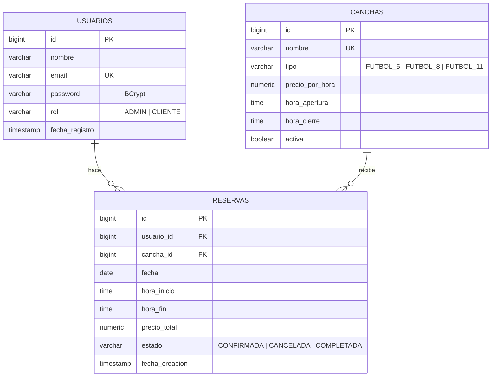

# CanchaYa

Aplicación web para la reserva de canchas deportivas: API REST con Spring Boot y frontend en React, desplegados juntos. Un negocio administra sus canchas y horarios, y los clientes consultan disponibilidad, reservan y cancelan.

## Tecnologías

| Capa | Tecnología |
| --- | --- |
| Lenguaje | Java 21 |
| Framework | Spring Boot 3.5 (Web, Data JPA, Security, Validation) |
| Seguridad | Spring Security + JWT (jjwt) |
| Base de datos | PostgreSQL 17 |
| Migraciones | Flyway |
| Documentación | Springdoc OpenAPI (Swagger UI) |
| Pruebas | JUnit 5, Mockito, AssertJ, JaCoCo |
| Contenedores | Docker, Docker Compose |
| Frontend | React 19, Vite, TypeScript, Tailwind CSS, TanStack Query |
| Build | Maven (wrapper incluido) y npm |

## Modelo de datos



## Cómo ejecutarlo

### Con Docker (recomendado)

```bash
git clone https://github.com/luisbon22/CanchaYa.git
cd CanchaYa
docker compose up --build
```

| Qué | URL |
| --- | --- |
| Aplicación web | `http://localhost:8080` |
| Swagger UI | `http://localhost:8080/swagger-ui.html` |
| API | `http://localhost:8080/api/...` |

Si el puerto 8080 está ocupado: `API_PORT=8081 docker compose up --build`.

Las variables (`DB_URL`, `DB_USER`, `DB_PASSWORD`, `JWT_SECRET`, `JWT_EXPIRATION`, `CORS_ORIGINS`) tienen valores por defecto para desarrollo; para cambiarlas copie `.env.example` como `.env`.

### Sin Docker

Requisitos: JDK 21, Node 20 o superior y un PostgreSQL local con una base `canchaya` (usuario y contraseña `canchaya`, o ajuste las variables de entorno).

```bash
cd frontend && npm ci && npm run build && cd ..
./mvnw spring-boot:run
```

`npm run build` deja el frontend en `src/main/resources/static`, así Spring Boot lo sirve en `http://localhost:8080`. Flyway crea las tablas y carga los datos iniciales al arrancar.

### Desarrollo del frontend

Con el backend corriendo en el puerto 8080:

```bash
cd frontend
npm run dev
```

Vite levanta `http://localhost:5173` con recarga en caliente y redirige las llamadas a `/api` hacia el backend.

### Pruebas

```bash
./mvnw test
```

El reporte de cobertura queda en `target/site/jacoco/index.html`.

## Usuarios de prueba

Creados por la migración `V2__datos_iniciales.sql`:

| Rol | Email | Contraseña |
| --- | --- | --- |
| ADMIN | `admin@canchaya.com` | `Admin123*` |
| CLIENTE | `cliente@canchaya.com` | `Cliente123*` |

También se cargan cuatro canchas de ejemplo.

## Endpoints

Todas las rutas, salvo las de autenticación, requieren el encabezado `Authorization: Bearer <token>`.

| Método | Ruta | Acceso | Descripción |
| --- | --- | --- | --- |
| POST | `/api/auth/register` | Público | Registra un usuario con rol `CLIENTE` |
| POST | `/api/auth/login` | Público | Devuelve un token JWT |
| GET | `/api/canchas` | Autenticado | Canchas activas, paginado y filtro `tipo` |
| GET | `/api/canchas/{id}` | Autenticado | Detalle de una cancha |
| POST | `/api/canchas` | ADMIN | Crea una cancha |
| PUT | `/api/canchas/{id}` | ADMIN | Actualiza una cancha |
| PATCH | `/api/canchas/{id}/estado` | ADMIN | Activa o desactiva una cancha |
| GET | `/api/canchas/{id}/disponibilidad?fecha=YYYY-MM-DD` | Autenticado | Franjas del día: `LIBRE`, `OCUPADA` o `PASADA` |
| POST | `/api/reservas` | CLIENTE | Crea una reserva |
| GET | `/api/reservas/mis-reservas` | CLIENTE | Reservas del usuario, paginado |
| GET | `/api/reservas` | ADMIN | Todas, con filtros `fecha`, `canchaId`, `estado` |
| GET | `/api/reservas/{id}` | Dueño o ADMIN | Detalle de una reserva |
| PATCH | `/api/reservas/{id}/cancelar` | Dueño o ADMIN | Cancela aplicando las reglas |
| GET | `/api/admin/resumen` | ADMIN | Reservas, canchas activas e ingresos del día |

### Ejemplo: crear una reserva

```http
POST /api/reservas
Authorization: Bearer <token>
Content-Type: application/json

{
  "canchaId": 1,
  "fecha": "2026-11-20",
  "horaInicio": "19:00",
  "horaFin": "21:00"
}
```

Respuesta `201 Created`:

```json
{
  "id": 15,
  "canchaId": 1,
  "cancha": "Cancha Principal",
  "usuarioId": 2,
  "usuario": "Cliente Demo",
  "fecha": "2026-11-20",
  "horaInicio": "19:00",
  "horaFin": "21:00",
  "precioTotal": 160000.00,
  "estado": "CONFIRMADA",
  "fechaCreacion": "2026-11-01T15:30:00"
}
```

### Formato de error

```json
{
  "timestamp": "2026-11-01T15:30:00",
  "status": 409,
  "error": "Conflict",
  "message": "La cancha ya está reservada en ese horario",
  "path": "/api/reservas"
}
```

| Código | Cuándo |
| --- | --- |
| 400 | Datos inválidos o regla de negocio incumplida |
| 401 | Sin token, token inválido o credenciales incorrectas |
| 403 | Sin permisos para el recurso |
| 404 | Recurso no encontrado |
| 409 | Reserva solapada o dato duplicado |

## Reglas de negocio

1. Reservas por horas completas, de 1 a 3 horas.
2. No se reserva en fechas u horas pasadas.
3. La reserva debe estar dentro del horario de apertura y cierre de la cancha.
4. No se reservan canchas inactivas.
5. No puede haber dos reservas `CONFIRMADA` solapadas en la misma cancha y fecha.
6. Un `CLIENTE` cancela solo sus reservas y con al menos 24 horas de anticipación.
7. Un `ADMIN` cancela cualquier reserva en cualquier momento.
8. El precio total lo calcula el backend (`horas × precioPorHora`).

## Decisiones técnicas

- **Reservas solapadas, dos capas de protección.**
  1. `ReservaService.crear` bloquea la fila de la cancha con `@Lock(PESSIMISTIC_WRITE)` (`SELECT ... FOR UPDATE`) antes de comprobar el solapamiento. Dos peticiones simultáneas sobre la misma cancha se validan una detrás de otra dentro de la misma transacción.
  2. PostgreSQL tiene una restricción de exclusión (`btree_gist`) que impide dos reservas confirmadas con rangos `tsrange` solapados para la misma cancha. Aunque algún camino de código se saltara el bloqueo, la base de datos responde con un error que la API traduce a `409`.
- **Reloj inyectable.** Los servicios reciben un `Clock` con la zona `America/Bogota`, lo que permite probar las reglas de "fecha pasada" y "24 horas" con una hora fija.
- **Reservas completadas.** Una tarea programada marca cada 15 minutos como `COMPLETADA` las reservas confirmadas que ya terminaron.
- **JWT sin estado.** El token lleva el email, id, nombre y rol; el filtro valida la firma y la vigencia en cada petición. Los errores 401/403 de la cadena de seguridad usan el mismo formato JSON que el resto de la API.
- **Registro seguro.** `/api/auth/register` siempre crea usuarios `CLIENTE`; los administradores se crean desde la base de datos.
- **Monolito, un solo despliegue.** El frontend (React) vive en `frontend/` y su build se empaqueta dentro del jar de Spring Boot. El `Dockerfile` compila primero el frontend con Node, luego el backend con Maven y produce una única imagen. Frontend y API comparten origen, así que en producción no hace falta CORS; `SpaConfig` sirve los archivos del build y devuelve `index.html` en las rutas del frontend para que recargar `/canchas/1` funcione.
- **CORS** configurable con `CORS_ORIGINS`, solo necesario si el frontend se sirve desde otro dominio.

## Despliegue

Una sola imagen Docker con la aplicación completa. En Render o Railway: crear un PostgreSQL, desplegar el repositorio usando el `Dockerfile` y definir `DB_URL`, `DB_USER`, `DB_PASSWORD` y `JWT_SECRET`.

## Estructura

```
frontend/         # React + Vite + TypeScript (ver frontend/README.md)
src/main/java/com/luisbonilla/canchaya
├── config        # SecurityConfig, OpenApiConfig, TiempoConfig, SpaConfig
├── controller    # AuthController, CanchaController, ReservaController, AdminController
├── dto           # request / response
├── entity        # Usuario, Cancha, Reserva y enums
├── exception     # GlobalExceptionHandler y excepciones de negocio
├── mapper        # entidad -> DTO
├── repository    # repositorios JPA y especificaciones
├── security      # JwtService, JwtAuthenticationFilter, UserDetailsServiceImpl
└── service       # AuthService, CanchaService, ReservaService, AdminService
```
